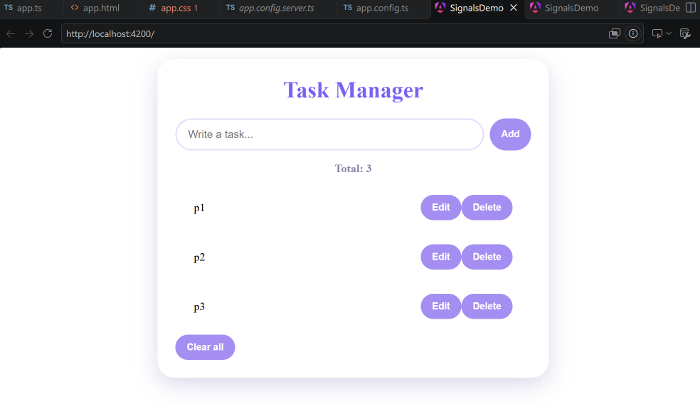

@'
# Task Manager - Angular Signals Demo

A simple task manager built with Angular signals.

## Demo

## Concepts used

- `signal()`: store tasks and input text
- `set()`: clear the input and the list
- `update()`: add, edit and delete tasks
- `computed()`: total number of tasks
- `effect()`: save tasks automatically in localStorage
- Zoneless change detection

## Run

    npm install
    ng serve -o
'@ | Set-Content README.md